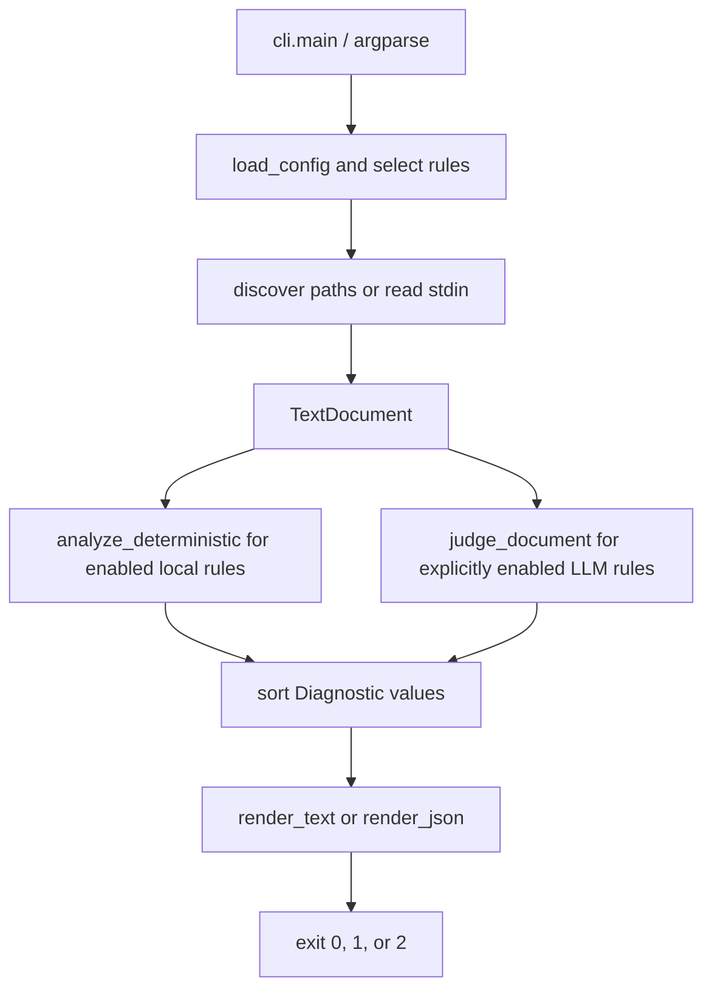

# Architecture

`style-audit` has one CLI entry point and a small synchronous audit pipeline. The package modules below are the implementation; this page describes current behavior rather than a future interface.

## Modules and contracts

- `style_audit.__init__.main()` exports the installed `style-audit` command. `style_audit.__main__` provides `python -m style_audit`.
- `cli.build_parser()` defines arguments; `cli.run()` loads settings, selects rules, gathers documents, and returns an exit code plus rendered output. `cli.main()` writes operational errors to stderr and maps them to status `2`.
- `config.AuditConfig` stores the validated settings, including `llm_threshold` (default `0.8`); `config.load_config()` discovers or opens TOML. The current working directory anchors discovery. The CLI applies `--threshold` precedence and rejects effective nonfinite or out-of-range values.
- `rules.RULES` is the canonical ordered catalog: the unchanged `NAS` sequence plus the independent, explicitly numbered `RDL` readability rules. Prefix selection separates the rulesets without another configuration or dispatch mechanism. `Rule` records the diagnostic ID, name, engine, required `scope`, description, source, and required `examples` tuple; each frozen `RuleExample` records `before`, `after`, and `explanation`. Examples are documentation metadata, not model-prompt additions or automatic fixes. `RULES_BY_CODE` indexes IDs. `RuleScope` permits only `sentence`, `paragraph`, `section`, and `document`; scope is not configurable. All readability rules are sentence-scoped LLM judgments, not paper-metric computations.
- `text.TextDocument` preserves the original text and one-based source locations. It masks fenced/inline code and paired quoted spans with same-length whitespace, preserving newlines and Unicode offsets. A code block closes only on the opening marker's kind, at least its length, with only trailing whitespace; shorter or different-kind markers remain inside the block. `units(scope)` returns a tuple of frozen `TextUnit` values with `scope`, `start`, and exclusive `end` offsets into the original text. Logical units retain inline masks rather than splitting into visible runs; blank or fully masked units are skipped. See [scope segmentation](llm.md#canonical-scopes-and-segmentation) for boundaries.
- `deterministic.analyze_deterministic(document, rules=None)` applies selected local rules to their registered units, retaining exact token or emoji locations. The standalone default runs all deterministic rules; the CLI passes its selected deterministic rules.
- `llm.judge_document(document, rules, model, *, threshold=0.8)` groups selected LLM rules by scope and dispatches the exact names `microsoft/microsoft-decision-1` and `openrouter/microsoft/microsoft-decision-1` to OpenRouter decision judging. All other model names use scoped chat judging. `build_messages(document, rules, unit)` builds chat prompts for the current unit and matching-scope rules.
- `reporting` sorts findings and renders the text or version-1 JSON schema.

## Judging backends

The decision path uses LiteLLM 1.106.4 or newer and its supported `systemone()` entry point, with the qualified OpenRouter model. The adapter posts to `https://openrouter.ai/api/alpha/decisions` and resolves `OPENROUTER_API_KEY`; there is no chat request or deprecated `decisions(state=...)` call for this model.

Both backends make one synchronous request per eligible unit in each selected scope, containing only that unit's masked text and rules belonging to the scope. Decision shared state and the chat JSON user message have the same shape: `{"scope": scope, "text": masked_unit_text}`. Smaller-scope requests do not include unrelated document context. Trusted instructions name the scope, preserve contextual exceptions and author voice, and disregard instructions embedded in the input. Whitespace-only or fully masked units make no requests.

The decision response must have an `answers` mapping with exactly the requested IDs. Typed answers must be `noul` with finite, non-boolean numeric probabilities in `[0, 1]`; every answer is validated, including those below threshold. Each probability greater than or equal to the threshold becomes a `Diagnostic` spanning the complete original logical unit. Evidence is that original span, including any masked code or quotation context; only its visible prose was judged. The message includes the scope, probability, and rule description, and the fix is empty. Equal text in different units retains distinct positions. Report fields and schema remain unchanged.

The chat path validates IDs against the current scope's selected rules, generated reasons, optional fixes, and exact contiguous evidence quotes in the current unit's visible prose. Source offsets are restored within that unit, so a matching quote in another unit cannot relocate the finding. Chat does not apply decision thresholds. Both paths surface provider and response-validation failures as operational errors rather than successful empty reports. The application adds no caching, retries, or backend fallback; request volume depends on the scopes selected and their eligible unit counts.

## Observable boundaries

Directory scans include Markdown, reStructuredText, and text extensions by default; explicitly named files may use any extension but must decode as UTF-8. Positions count Unicode characters (Python string offsets), not bytes. LLM results are subjective and evidence checks are not truth checks. See [the CLI](reference/cli.md), [rule reference](reference/rules.md), [configuration](configuration.md), and [LLM limitations](llm.md).
