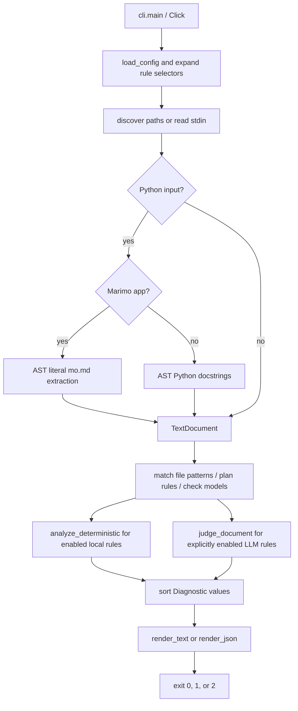

# Architecture

`style-audit` has one CLI entry point and a small synchronous audit pipeline. The package modules below are the implementation. This page describes current behavior rather than a future interface.

## Modules and contracts

- `style_audit.__init__.main()` exports the installed `style-audit` command. `style_audit.__main__` provides `python -m style_audit`.
- `cli.build_cli()` defines the Click command, and `cli.run()` loads settings, expands rule IDs, prefixes, and globs, gathers documents, plans each file's effective rules and model requirements, and returns an exit code plus rendered output. Matching per-file selections replace global selection with their union. CLI selection replaces both, and combined ignores always win. Plans are shared by all extracted documents of a file and validated before any provider call. `cli.main()` writes operational errors to stderr and maps them to status `2`.
- `config.AuditConfig` stores the validated settings, including immutable `per_file_select` entries. `config.load_config()` discovers or opens TOML. The current working directory anchors discovery, while the TOML directory anchors per-file path matching. Unmatched `.md` inputs default to `NAS` and `RDL`; this does not enable LLM judging. Explicit selection and matching per-file rules override the default.
- `AuditConfig`, `LiteLLMConfig`, `Rule`, `RuleExample`, `Diagnostic`, `CLIOptions`, `TextUnit`, `SourceMap`, and `TextDocument` use frozen, strict Pydantic `BaseModel`s. Text records are constructed with named fields; `TextDocument` keeps derived segmentation state private. Diagnostic JSON uses `model_dump`, and resolved provider API keys are excluded from settings serialization.
- `rules.RULES` is the canonical ordered catalog loaded from the packaged per-ruleset YAML files under `src/style_audit/rules/` in stable NAS, RDL, STE, and MWG order. It contains validated IDs, scopes, prompts/descriptions, examples, and detector definitions: the NAS sequence, explicitly numbered RDL readability rules, all 61 ASD-STE100 Part 1 entries, and 13 general Microsoft Writing Style judgments. The supplied PDF's Part 2 controlled dictionary is not ingested. `STE606` and `STE801` use deterministic checks; other STE entries and all MWG entries use contextual LLM review.
- `rule_catalog.load_project_rule_catalogs()` loads project-relative YAML files named by configuration, rejects paths escaping the TOML root and duplicate IDs, and returns validated custom rules. `AuditConfig.project_rules` carries these into the CLI beside bundled `rules.RULES`; custom codes use the same selector, deterministic, reporting, and LLM paths.
- `Rule` records the diagnostic ID, name, engine, required `scope`, description, source, examples, and optional deterministic detector. YAML `prompt` values become the runtime instruction used by chat judging. Regex detectors declare Python patterns, flags, matching target, message, and fix; sentence count remains a typed algorithmic detector.
- `RuleScope` permits only `sentence`, `paragraph`, `section`, and `document`. Scope is not configurable. All `RDL` rules are sentence-scoped LLM judgments, not paper-metric computations.
- `text.TextDocument` segments audited prose and reports one-based source locations. It masks fenced/inline code and paired quoted spans with same-length whitespace, preserving newlines and Unicode offsets. A code block closes only on the opening marker's kind, at least its length, with only trailing whitespace. Shorter or different-kind markers remain inside the block.
- `units(scope)` returns frozen `TextUnit` values with `scope`, `start`, and exclusive `end` offsets into `document.text`. Logical units retain inline masks rather than splitting into visible runs. Blank or fully masked units are skipped.
- For extracted docstrings and Marimo Markdown, an optional `SourceMap` stores each decoded prose character's original Python source span. `position()`, `span()`, and `evidence()` restore original locations and source spelling while segmentation and quote validation use normalized prose. See [scope segmentation](llm.md#canonical-scopes-and-segmentation).
- `docstrings.extract_docstrings(path, source)` parses ordinary Python without execution and extracts module/class/function/async-function docstrings, including nested definitions. AST byte columns are converted to Unicode offsets. String tokens are decoded and mapped through escapes, adjacent literals, UTF-8 BOM, and universal newlines; cleaning follows `inspect.cleandoc` while retaining positions. Code and comments never enter the audited text.
- `marimo_docs.extract_markdown_cells(path, source)` recognizes imported `marimo.App` calls, then extracts direct `mo.md()` string literals and static f-string portions without executing cells. Interpolations and nonliteral arguments are omitted. Each Markdown call becomes a source-mapped `TextDocument`; syntax or mapping errors raise `AuditError` without raw-source fallback.
- `gherkin.document_from_feature(path, source)` masks Gherkin syntax and fixtures while preserving source positions and step boundaries. It does not load step definitions or execute scenarios.
- `deterministic.analyze_deterministic(document, rules=None)` applies selected local checks to their registered units, retaining exact token or emoji locations. The standalone default runs all deterministic rules. The CLI passes its selected deterministic rules.
- `llm.judge_document(document, rules, model, *, api="completion", threshold=0.82, confidence_scores=None, litellm_config=...)` groups selected LLM rules by scope and calls either LiteLLM chat completions or its provider-neutral Decisions API. Completion findings use validated quote-level spans; Decisions findings use the full visible scope unit and a validated probability threshold. The optional confidence collector records every Decisions probability, including below-threshold results.
- `reporting` sorts findings and optional confidence scores, then renders text or version-1 JSON; confidence fields appear only when requested.

## LLM judging APIs

For each eligible unit in every selected scope, completion mode makes one synchronous `litellm.completion` request. The request contains only the matching-scope rules, their guidance/examples, and the masked unit as JSON. Smaller-scope requests do not include unrelated document context. The model returns a structured findings array with rule IDs, reasons, and exact contiguous evidence quotes; the application validates IDs, fields, and quotes against the current unit.

When `[tool.style-audit.llm].api = "decisions"`, style-audit makes `litellm.decisions` calls with one predicate question per rule, grouped in batches of at most 128. Each answer must name the requested rule and contain a finite probability in `[0, 1]`. Findings at or above the configured threshold cover the complete visible scope unit because this API does not return phrase-level evidence or a rationale.

Provider and response-validation failures are operational errors rather than successful empty reports. The application adds no caching or retries. Request volume depends on the scopes selected and their eligible unit counts.

## Observable boundaries

Directory scans include Markdown, reStructuredText, text, Gherkin `.feature`, Python, and Python-stub files by default. Ordinary Python inputs audit docstrings; recognized Marimo apps audit literal Markdown cell text. Gherkin inputs use a syntax-aware pass that masks syntax prefixes, full-line tags, comments, table rows, and docstring fixtures while retaining heading descriptions and step prose. No Python app or Gherkin scenario is executed. Other explicitly named files are prose. All files must decode as UTF-8.

Positions count original Unicode characters, not bytes. Decoded docstring, Marimo Markdown, and Gherkin evidence map to their source spelling. LLM results are subjective, and evidence checks are not truth checks. See [the CLI](reference/cli.md), [rule reference](reference/rules.md), [configuration](configuration.md), and [LLM limitations](llm.md).
