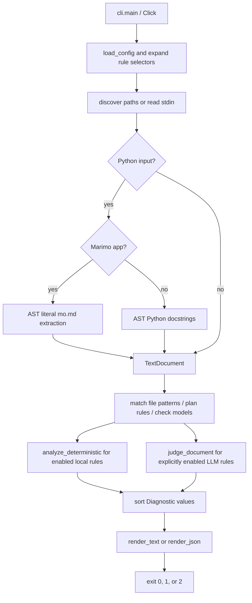

# Architecture

`style-audit` has one CLI entry point and a small synchronous audit pipeline. The package modules below are the implementation. This page describes current behavior rather than a future interface.

## Modules and contracts

- `style_audit.__init__.main()` exports the installed `style-audit` command. `style_audit.__main__` provides `python -m style_audit`.
- `cli.build_cli()` defines the Click command, and `cli.run()` loads settings, expands rule IDs, prefixes, and globs, gathers documents, plans each file's effective rules and model requirements, and returns an exit code plus rendered output. Matching per-file selections replace global selection with their union. CLI selection replaces both, and combined ignores always win. Plans are shared by all extracted documents of a file and validated before any provider call. `cli.main()` writes operational errors to stderr and maps them to status `2`.
- `config.AuditConfig` stores the validated settings, including immutable `per_file_select` entries and `llm_threshold` (default `0.8`). `config.load_config()` discovers or opens TOML. The current working directory anchors discovery, while the TOML directory anchors per-file path matching. Unmatched `.md` inputs default to `NAS` and `RDL`; this does not enable LLM judging. Explicit selection and matching per-file rules override the default. The CLI applies `--threshold` precedence and rejects effective nonfinite or out-of-range values.
- `AuditConfig`, `LiteLLMConfig`, `Rule`, `RuleExample`, `Diagnostic`, `CLIOptions`, `DecisionAPISettings`, `TextUnit`, `SourceMap`, and `TextDocument` use frozen, strict Pydantic `BaseModel`s. Text records are constructed with named fields; `TextDocument` keeps derived segmentation state private. Diagnostic JSON uses `model_dump`, and resolved provider API keys are excluded from settings serialization.
- `rules.RULES` is the canonical ordered catalog. It contains the unchanged `NAS` sequence, the explicitly numbered `RDL` readability rules, and 61 ASD-STE100 Part 1 entries assembled from `ste_rules.STE_RULES`. `STE` IDs cover all 53 Issue 9 writing rules and eight general recommendations. The supplied PDF's Part 2 controlled dictionary is not ingested by this catalog. Two measurable entries (`STE606`, `STE801`) use deterministic checks, and the rest use contextual LLM review. Prefix selection separates rulesets without another dispatch mechanism.
- `Rule` records the diagnostic ID, name, engine, required `scope`, description, source, and required `examples` tuple. Each frozen `RuleExample` records `before`, `after`, and `explanation`. Examples are documentation metadata, not model-prompt additions or automatic fixes. `RULES_BY_CODE` indexes IDs.
- `RuleScope` permits only `sentence`, `paragraph`, `section`, and `document`. Scope is not configurable. All `RDL` rules are sentence-scoped LLM judgments, not paper-metric computations.
- `text.TextDocument` segments audited prose and reports one-based source locations. It masks fenced/inline code and paired quoted spans with same-length whitespace, preserving newlines and Unicode offsets. A code block closes only on the opening marker's kind, at least its length, with only trailing whitespace. Shorter or different-kind markers remain inside the block.
- `units(scope)` returns frozen `TextUnit` values with `scope`, `start`, and exclusive `end` offsets into `document.text`. Logical units retain inline masks rather than splitting into visible runs. Blank or fully masked units are skipped.
- For extracted docstrings and Marimo Markdown, an optional `SourceMap` stores each decoded prose character's original Python source span. `position()`, `span()`, and `evidence()` restore original locations and source spelling while segmentation and quote validation use normalized prose. See [scope segmentation](llm.md#canonical-scopes-and-segmentation).
- `docstrings.extract_docstrings(path, source)` parses ordinary Python without execution and extracts module/class/function/async-function docstrings, including nested definitions. AST byte columns are converted to Unicode offsets. String tokens are decoded and mapped through escapes, adjacent literals, UTF-8 BOM, and universal newlines; cleaning follows `inspect.cleandoc` while retaining positions. Code and comments never enter the audited text.
- `marimo_docs.extract_markdown_cells(path, source)` recognizes imported `marimo.App` calls, then extracts direct `mo.md()` string literals and static f-string portions without executing cells. Interpolations and nonliteral arguments are omitted. Each Markdown call becomes a source-mapped `TextDocument`; syntax or mapping errors raise `AuditError` without raw-source fallback.
- `gherkin.document_from_feature(path, source)` masks Gherkin syntax and fixtures while preserving source positions and step boundaries. It does not load step definitions or execute scenarios.
- `deterministic.analyze_deterministic(document, rules=None)` applies selected local checks to their registered units, retaining exact token or emoji locations. The standalone default runs all deterministic rules. The CLI passes its selected deterministic rules.
- `llm.judge_document(document, rules, model, *, threshold=0.8, litellm_config=...)` groups selected LLM rules by scope and routes Decisions selectors through LiteLLM `systemone`. An explicit unsupported-endpoint response on the first Decisions request switches the full audit to standard chat completions; other model names use chat directly. `build_messages(document, rules, unit)` builds the chat prompt for the current unit and matching-scope rules.
- `reporting` sorts findings and renders the text or version-1 JSON schema.

## Judging backends

Decision judging calls LiteLLM's `systemone` API. The OpenRouter selector `openrouter/microsoft/microsoft-decision-1` uses `OPENROUTER_API_KEY` and OpenRouter's `/alpha/decisions` endpoint, with `https://openrouter.ai/api` as the default API base. The Azure MaaS path uses its configured `api_base`, API key, and `custom_llm_provider` (default `openai`); the OMP provider `azure-maas-judge` uses `api: openrouter-decisions` and lists the model ID. That API identifier selects the Decisions interface, not the OpenRouter service.

For a Microsoft Foundry project endpoint, set `custom_llm_provider = "azure_ai"`. LiteLLM routes it to `/providers/microsoft/v1/systemone`. An OpenAI-compatible base ending `/openai/v1` uses `custom_llm_provider = "openai"` and the `/openai/v1/decisions` route. Style-audit passes the configured base and key, and LiteLLM validates Decisions responses. Other models retain LiteLLM chat-completion judging.

Both backends make one synchronous request per eligible unit in each selected scope, containing only that unit's masked text and rules belonging to the scope. Decision calls pass `{"scope": scope, "text": masked_unit_text}` as structured state to the configured provider's Decisions adapter, which serializes it into the provider request. Chat calls place the same values in a JSON user message. Smaller-scope requests do not include unrelated document context. Trusted instructions name the scope, preserve contextual exceptions and author voice, and disregard instructions embedded in the input. Whitespace-only or fully masked units make no requests.

The decision response must have an `answers` mapping with exactly the requested IDs. Typed answers must be `noul` with finite, non-boolean numeric probabilities in `[0, 1]`. Every answer is validated, including those below threshold. Each probability greater than or equal to the threshold becomes a `Diagnostic` spanning the complete original logical unit. Evidence is that original span, including any masked code or quotation context. Only its visible prose was judged.

The message includes the scope, probability, and rule description, and the fix is empty. Equal text in different units retains distinct positions. Report fields and schema remain unchanged.

The chat path validates IDs against the current scope's selected rules, generated reasons, optional fixes, and exact contiguous evidence quotes in the current unit's visible prose. Source offsets are restored within that unit, so a matching quote in another unit cannot relocate the finding. Chat does not apply decision thresholds. Both paths surface provider and response-validation failures as operational errors rather than successful empty reports. The application adds no caching, retries, or backend fallback. Request volume depends on the scopes selected and their eligible unit counts.

## Observable boundaries

Directory scans include Markdown, reStructuredText, text, Gherkin `.feature`, Python, and Python-stub files by default. Ordinary Python inputs audit docstrings; recognized Marimo apps audit literal Markdown cell text. Gherkin inputs use a syntax-aware pass that masks syntax prefixes, full-line tags, comments, table rows, and docstring fixtures while retaining heading descriptions and step prose. No Python app or Gherkin scenario is executed. Other explicitly named files are prose. All files must decode as UTF-8.

Positions count original Unicode characters, not bytes. Decoded docstring, Marimo Markdown, and Gherkin evidence map to their source spelling. LLM results are subjective, and evidence checks are not truth checks. See [the CLI](reference/cli.md), [rule reference](reference/rules.md), [configuration](configuration.md), and [LLM limitations](llm.md).
